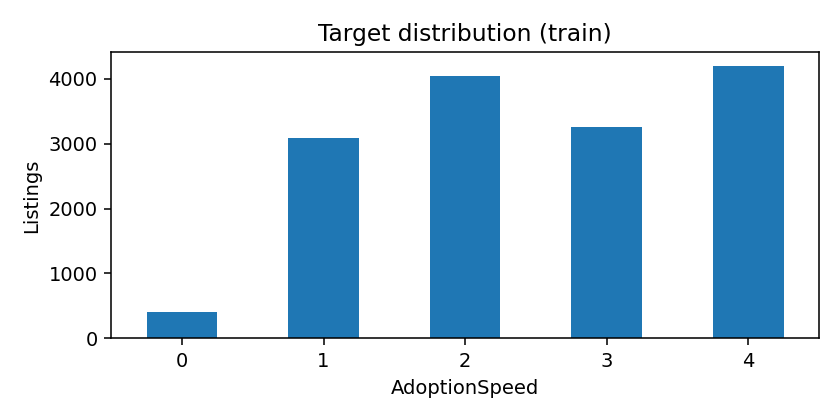

# PetFinder.my: прогноз скорости пристройства животных

Проект для [ДЗ1](HomeWork_1.md). Я сравнил пять моделей на данных PetFinder: табличный бейзлайн получил **QWK 0.2594 +- 0.0201**, лучший CatBoostClassifier — **0.3299 +- 0.0205**. Здесь среднее и стандартное отклонение по пяти фолдам.

[Выполненный ноут](notebooks/adoption_prediction_notebook.ipynb) ·
[Подробный разбор](reports/2026-11-08_group_cv_seed42/analysis.md) ·
[Файлы результатов](reports/README.md)

## Задача

Нужно предсказывать `AdoptionSpeed` — категорию времени до пристройства животного. Объект наблюдения — объявление. Оно может представлять несколько животных. В таком случае метка относится к пристройству всей группы.

| Класс | Время до пристройства |
|---|---|
| 0 | В день публикации |
| 1 | 1–7 дней |
| 2 | 8–30 дней |
| 3 | 31–90 дней |
| 4 | Не пристроено после 100 дней |

Это многоклассовая классификация. Интервалы неравномерны, поэтому регрессия по кодам 0–4 не предсказывает точное число дней. Класс 4 также не означает, что животное никогда не будет пристроено.

`X` — характеристики животного и объявления: возраст, вид, породы, цвета, пол, размер, шерсть, здоровье, ветеринарные статусы, количество животных, цена, регион, число фото и видео. В отдельном эксперименте добавляется `Description`.
`y` — целое число от 0 до 4. Одно предсказание соответствует одному `PetID`.
`PetID` нужен для сопоставления строк, `RescuerID` — для группировки при валидации. В модели эти поля и `Name` не используются.

Практический смысл — находить объявления, которым может понадобиться продвижение. При этом в данных нет истории изменений карточки: нельзя подтвердить, что все описания, фото и статусы были доступны именно в день публикации.

## Данные и EDA

Источник — [PetFinder.my Adoption Prediction](https://www.kaggle.com/competitions/petfinder-adoption-prediction/data).
В CSV находятся таблица и текст, target есть только в train. Дополнительно доступны JPG, справочники категорий, sentiment JSON для описаний и Vision JSON для изображений. Для первого этапа использованы таблица и текст. Фото и JSON проверялись в EDA.

В train 14 993 объявления и 24 столбца с target, в test — 3 972 объявления и 23 столбца. В 19 табличных признаках нет NaN, но встречаются неопределенные статусы: например, Vaccinated=3 нельзя считать ответом «нет». Description отсутствует в 13 строках train и одной test. У Name пропусков больше, но этот признак не используется. Fee=0 означает бесплатное пристройство и не заменяется пропуском.

Классы несбалансированы: у редкого класса 0 всего 410 примеров (2.73%), остальные классы занимают от 20.61% до 27.99% train.



PetID уникальны, авторы train/test не пересекаются. Есть повторяющиеся описания, в том числе с разными метками и между train/test. Это могут быть шаблоны разных объявлений. Сами по себе повторы не доказывают ошибку разметки. Возможный шум — неточные сведения автора, задержка обновления статуса пристройства и широкие интервалы target. Риски утечки описаны в протоколе ниже.

Подробные проверки CSV, фото и JSON сохранены в [аудите EDA](reports/2026-11-08_group_cv_seed42/eda/audit.json), [числовые распределения](reports/2026-11-08_group_cv_seed42/eda/numeric_distributions.png) — отдельно. Новые категории test обрабатываются через OHE с игнорированием неизвестных значений и нативные категории CatBoost.

## Бейзлайн и гипотезы

Основной бейзлайн — Logistic Regression по 19 табличным полям. Это быстрая модель без сложных признаков, с которой удобно сравнивать последующие изменения. DummyClassifier нужен как контроль: он выбирает самый частый класс train-фолда.

| Модель | Подготовка данных и параметры |
|---|---|
| logreg_tabular | 5 числовых: медиана + StandardScaler, 14 категориальных: OHE. C=1, lbfgs, max_iter=1500 |
| logreg_text | То же + word TF-IDF по Description: 1–2 граммы, до 20 000 признаков, min_df=1, sublinear_tf |
| catboost_classifier | 19 табличных полей, нативные категории, MultiClass, 400 деревьев, depth=6, lr=0.05, l2=3 |
| catboost_regressor | Те же поля и параметры деревьев, RMSE, границы классов 0.5/1.5/2.5/3.5 |

Числовые поля — `Age`, `Quantity`, `Fee`, `VideoAmt`, `PhotoAmt`. Категориальные перечислены в [src/data.py](src/data.py). Коды категорий не считаются числовыми расстояниями. Пропуски категорий получают отдельное значение. Числовые NaN у CatBoost обрабатываются самой библиотекой. В TF-IDF не удаляются stopwords, поскольку описания многоязычные. Общий служебный токен позволяет обработать даже train-фолд, в котором все описания пустые.

Основная гипотеза: текст дополнит сведения из таблицы и даст **не менее +0.02 mean QWK**  к той же Logistic Regression. Дополнительный критерий — нижняя граница парного группового bootstrap-интервала для разницы pooled OOF QWK выше нуля.

| Исследовательский вопрос | Критерий | Результат |
|---|---|---|
| H1: помогает ли TF-IDF сверх таблицы? | Прирост mean QWK >=0.02 и положительный bootstrap-интервал | +0.0074, интервал включает ноль, критерий не выполнен |
| H2: лучше ли CatBoost линейного бейзлайна на тех же полях? | Прирост mean QWK >=0.03 | +0.0705, критерий выполнен на этом запуске |
| H3: помогает ли RMSE-регрессия по кодам классов? | Прирост mean QWK >=0.01 к CatBoostClassifier при меньшей MAE | QWK ниже на 0.0740, несмотря на меньшую MAE |

## Протокол оценки

Основная метрика — [Quadratic Weighted Kappa](https://www.kaggle.com/competitions/petfinder-adoption-prediction/overview/evaluation). Она учитывает порядок классов и сильнее штрафует большие расхождения.
Расчет: `cohen_kappa_score(y, pred, labels=[0,1,2,3,4], weights="quadratic")`. Дополнительно смотрю macro-F1, accuracy, MAE по кодам классов, recall класса 0 и долю ошибок на две категории и больше.

Валидация — **5-fold StratifiedGroupKFold по RescuerID, seed=42**. Карточки одного автора могут быть похожи, поэтому они попадают только в один validation-фолд. В данном train/test авторы также различаются. Все модели используют одни фолды. Предсказания вне обучения (OOF) и разбиение сохранены в результатах. Imputer, scaler, OHE и TF-IDF обучаются только внутри train-фолда. Внешний val не используется для early stopping или выбора порогов. Лучшая модель выбирается по mean fold QWK.

Пересечений авторов между фолдами нет, но 334 validation-строки (2.23% всех OOF) имеют описание из своего train-фолда. Это остаточный риск утечки, требующий осмотра текстов и более строгого разбиения при наличии реальных дубликатов. Обновления карточек после пристройства также не проверены. Без временных меток временной split не построить. Один seed и выбор из нескольких моделей ограничивают надежность оценки.
Bootstrap пересэмплирует целых авторов и относится к уже обученным OOF-моделям. Он не учитывает всю вариативность переобучения.

## Результаты и ошибки

| Модель | Mean QWK +- fold std |
|---|---|
| dummy | 0.0000 +- 0.0000 |
| logreg_tabular | 0.2594 +- 0.0201 |
| logreg_text | 0.2668 +- 0.0162 |
| catboost_regressor | 0.2559 +- 0.0121 |
| catboost_classifier | **0.3299 +- 0.0205** |

Три примера ошибок табличного бейзлайна. Последний столбец показывает, что изменилось у лучшего CatBoost на том же validation-фолде:

| PetID | Признаки | y | Logistic Regression | CatBoost |
|---|---|---:|---:|---:|
| 6296e909a | Кот, 1 месяц, 1 животное, 2 фото | 0 | 4 | 1 |
| 3422e4906 | Собака, 1 месяц, 1 животное, 7 фото | 3 | 2 | 2 |
| 234a5a54c | Собака, 3 месяца, 3 животных, 5 фото | 4 | 2 | 2 |

По OOF бейзлайн почти не распознаёт редкий класс 0, смешивает соседние интервалы и для части долгих пристройств даёт слишком оптимистичный прогноз. CatBoost уменьшил первую ошибку, но тоже не распознал класс 0. Причины отдельных случаев по текстам и фото ещё не проверены.
Дополнительные метрики, bootstrap-интервал для H1, матрицы ошибок и сравнение на срезах — в [подробном разборе](reports/2026-11-08_group_cv_seed42/analysis.md).

## Выводы

Таблица дает полезный сигнал, CatBoostClassifier получил лучший QWK. Добавление TF-IDF к линейной модели не дало требуемого прироста. RMSE-регрессия снизила MAE, но почти все ее ответы попали в классы 2 и 3, а QWK оказался хуже классификатора.
Также нужны осмотр дубликатов и повторение оценки с другими seed.

Следующая гипотеза для ДЗ2: веса классов повысят recall класса 0 без снижения mean QWK более чем на 0.01. Здесь эта гипотеза ещё не проверялась.

## Запуск

Архив должен находиться в `data/petfinder-adoption-prediction.zip`. После клонирования его можно получить через `git lfs pull` (нужен установленный Git LFS).

Из корня `RND_ML_course_ITMO`:

```bash
python3 -m venv .venv
source .venv/bin/activate
cd adoption_prediction
python -m pip install -r requirements-notebook.txt
jupyter lab notebooks/adoption_prediction_notebook.ipynb
```

В VS Code можно открыть этот же ноутбук и выбрать Python из `.venv`. Ноутбук запускает пять моделей из `configs/experiments.yaml` на CPU. CSV распакуются автоматически в `data/raw/`, результаты появятся в `outputs/`.

Для запуска только бейзлайна и Dummy без ноутбука из `adoption_prediction`: `bash scripts/run_baseline.sh`. Вместо ZIP можно передать путь к распакованным данным: `bash scripts/run_baseline.sh /path/to/data`.

## Проверки

```bash
python -m pip install -r requirements-dev.txt
python -m pytest tests -q
python scripts/verify_run.py --run-dir reports/2026-11-08_group_cv_seed42/experiments --refit-dir reports/2026-11-08_group_cv_seed42/refit --expected-test-rows 3972
```

Тесты используют небольшие синтетические данные и ZIP, включая повторную распаковку, LFS-указатель и проверку путей внутри архива. Последняя команда пересчитывает метрики по сохранённым реальным OOF без обучения. Новые артефакты пишутся в `outputs/`, а результаты первого запуска для сдачи остаются в `reports/`.
