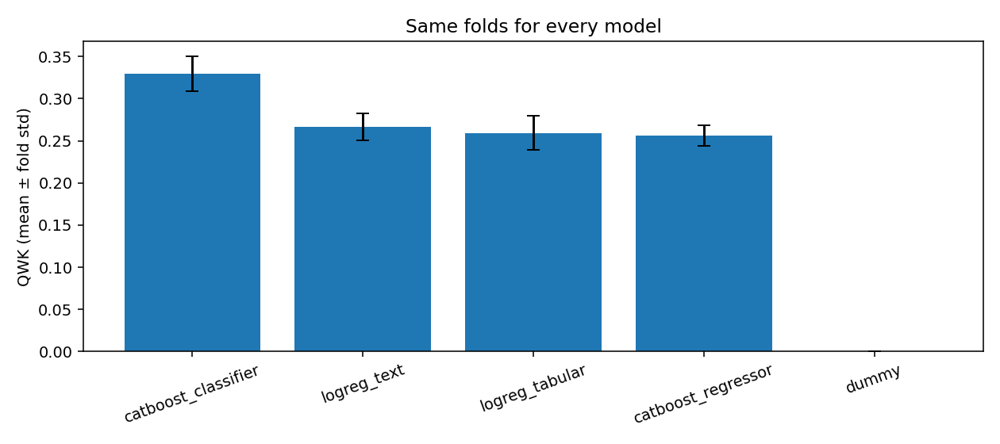

# PetFinder.my: прогноз скорости пристройства животных

Проект для [ДЗ1](HomeWork_1.md). Я сравнил пять моделей на данных PetFinder: табличный бейзлайн получил **QWK 0.2594 +- 0.0201**, лучший CatBoostClassifier — **0.3299 +- 0.0205**. Здесь среднее и стандартное отклонение по пяти фолдам.

[Выполненный ноут](notebooks/01-kaggle-baseline_done.ipynb) ·
[Подробный разбор](reports/2026-11-08_group_cv_seed42/analysis.md) ·
[Файлы результатов](reports/README.md)

## Задача

Нужно предсказывать `AdoptionSpeed` — категорию времени до пристройства животного. Объект наблюдения — объявление. Оно может представлять несколько животных; в таком случае метка относится к пристройству всей группы.

| Класс | Время до пристройства |
|---|---|
| 0 | В день публикации |
| 1 | 1–7 дней |
| 2 | 8–30 дней |
| 3 | 31–90 дней |
| 4 | Не пристроено после 100 дней |

Это многоклассовая классификация с порядком классов. Интервалы неравномерны, поэтому регрессия по кодам 0–4 не предсказывает точное число дней. Класс 4 также не означает, что животное никогда не будет пристроено.

`X` — характеристики животного и объявления: возраст, вид, породы, цвета, пол, размер, шерсть, здоровье, ветеринарные статусы, количество животных, цена, регион, число фото и видео. В отдельном эксперименте добавляется `Description`.
`y` — целое число от 0 до 4. Одно предсказание соответствует одному `PetID`.
`PetID` нужен для сопоставления строк, `RescuerID` — для группировки при валидации;
в модели эти поля и `Name` не используются.

Практический смысл — находить объявления, которым может понадобиться продвижение. При этом в данных нет истории изменений карточки: нельзя подтвердить, что все описания, фото и статусы были доступны именно в день публикации.

## Данные и EDA

Источник — [PetFinder.my Adoption Prediction](https://www.kaggle.com/competitions/petfinder-adoption-prediction/data).
В CSV находятся таблица и текст, target есть только в train. Дополнительно доступны JPG, справочники категорий, sentiment JSON для описаний и Vision JSON для изображений. Для первого этапа использованы таблица и текст; фото и JSON проверялись в EDA.

| Характеристика | Train | Test |
|---|---:|---:|
| Объявления | 14 993 | 3 972 |
| Столбцы | 24, включая target | 23 |
| Авторы | 5 595 | 1 518 |
| Пропуски Name | 1 265 | 414 |
| Пропуски Description | 13 | 1 |
| Повторы непустых нормализованных описаний | 973 | 260 |
| Объявления без фото / Vision JSON | 341 | 114 |
| Объявления без sentiment JSON | 551 | 107 |

В 19 табличных признаках нет NaN. Неопределенные статусы все же встречаются: например, Vaccinated=3 у 1 868 объявлений train. Их нельзя считать ответом «нет». Некорректных проверяемых кодов и отрицательных числовых значений не обнаружено. Возраст: медиана 3 месяца, максимум 255; Fee: медиана 0, максимум 3 000. Нули не заменяются пропусками автоматически: Fee=0 означает бесплатное пристройство.

| Класс | Количество в train | Доля |
|---|---:|---:|
| 0 | 410 | 2.73% |
| 1 | 3 090 | 20.61% |
| 2 | 4 037 | 26.93% |
| 3 | 3 259 | 21.74% |
| 4 | 4 197 | 27.99% |

PetID уникальны; авторы train/test не пересекаются. У 121 нормализованного описания в train есть разные метки, 78 описаний test встречаются в train. Общий текст может быть шаблоном разных объявлений, поэтому это еще не доказательство ошибки разметки. Возможный шум — неточные сведения автора, задержка обновления статуса пристройства и широкие интервалы target. Проверяемые риски утечки описаны ниже.

Число JPG совпадает с PhotoAmt. В выборках до 100 JSON каждого типа и split ошибок разбора нет; все файлы полностью не проверялись. Новые категории test предусмотрены: OHE игнорирует неизвестные значения, CatBoost использует нативные категории. Статистики и графики сохранены в [EDA](reports/2026-11-08_group_cv_seed42/eda/audit.json).

## Бейзлайн и гипотезы

Основной бейзлайн — Logistic Regression по 19 табличным полям. Это быстрая модель без сложных признаков, с которой удобно сравнивать последующие изменения. DummyClassifier нужен как контроль: он выбирает самый частый класс train-фолда.

| Модель | Подготовка данных и параметры |
|---|---|
| logreg_tabular | 5 числовых: медиана + StandardScaler; 14 категориальных: OHE. C=1, lbfgs, max_iter=1500 |
| logreg_text | То же + word TF-IDF по Description: 1–2 граммы, до 20 000 признаков, min_df=1, sublinear_tf |
| catboost_classifier | 19 табличных полей, нативные категории; MultiClass, 400 деревьев, depth=6, lr=0.05, l2=3 |
| catboost_regressor | Те же поля и параметры деревьев; RMSE, границы классов 0.5/1.5/2.5/3.5 |

Числовые поля — `Age`, `Quantity`, `Fee`, `VideoAmt`, `PhotoAmt`;
категориальные перечислены в [src/data.py](src/data.py). Коды категорий не считаются числовыми расстояниями. Пропуски категорий получают отдельное значение; числовые NaN у CatBoost обрабатываются самой библиотекой. В TF-IDF не удаляются stopwords, поскольку описания многоязычные. Общий служебный токен позволяет обработать даже train-фолд, в котором все описания пустые.

Основная гипотеза: текст дополнит сведения из таблицы и даст **не менее +0.02 mean QWK**  к той же Logistic Regression. Дополнительный критерий — нижняя граница парного группового bootstrap-интервала для разницы pooled OOF QWK выше нуля.

| Исследовательский вопрос | Критерий | Результат |
|---|---|---|
| H1: помогает ли TF-IDF сверх таблицы? | Прирост mean QWK >=0.02 и положительный bootstrap-интервал | +0.0074; интервал включает ноль, критерий не выполнен |
| H2: лучше ли CatBoost линейного бейзлайна на тех же полях? | Прирост mean QWK >=0.03 | +0.0705; критерий выполнен на этом запуске |
| H3: помогает ли RMSE-регрессия по кодам классов? | Прирост mean QWK >=0.01 к CatBoostClassifier при меньшей MAE | QWK ниже на 0.0740, несмотря на меньшую MAE |

Следующая гипотеза и условия ее проверки — в [плане экспериментов](docs/experiments.md).

## Протокол оценки

Основная метрика — [Quadratic Weighted Kappa](https://www.kaggle.com/competitions/petfinder-adoption-prediction/overview/evaluation). Она учитывает порядок классов и сильнее штрафует большие расхождения.
Расчет: `cohen_kappa_score(y, pred, labels=[0,1,2,3,4], weights="quadratic")`. Дополнительно смотрю macro-F1, accuracy, MAE по кодам классов, recall класса 0 и долю ошибок на две категории и больше.

Валидация — **5-fold StratifiedGroupKFold по RescuerID, seed=42**. Карточки одного автора могут быть похожи, поэтому они попадают только в один validation-фолд. В данном train/test авторы также различаются. Все модели используют одни фолды; предсказания вне обучения (OOF) и разбиение сохранены в результатах. Imputer, scaler, OHE и TF-IDF обучаются только внутри train-фолда. Внешний val не используется для early stopping или выбора порогов. Лучшая модель выбирается
по mean fold QWK; test и leaderboard в выборе не участвуют.

Пересечений авторов между фолдами нет, но 334 validation-строки (2.23% всех OOF) имеют описание из своего train-фолда. Это остаточный риск утечки, требующий осмотра текстов и более строгого разбиения при наличии реальных дубликатов. Обновления карточек после пристройства также не проверены. Без временных меток временной split не построить. Один seed и выбор из нескольких моделей ограничивают надежность оценки.
Bootstrap пересэмплирует целых авторов и относится к уже обученным OOF-моделям; он не учитывает всю вариативность переобучения.

## Результаты и ошибки

| Модель | Mean QWK +- fold std | OOF macro-F1 | OOF MAE |
|---|---|---:|---:|
| dummy | 0.0000 +- 0.0000 | 0.1188 | 1.4243 |
| logreg_tabular | 0.2594 +- 0.0201 | 0.2678 | 1.0424 |
| logreg_text | 0.2668 +- 0.0162 | 0.2756 | 1.0368 |
| catboost_regressor | 0.2559 +- 0.0121 | 0.1660 | **0.8882** |
| catboost_classifier | **0.3299 +- 0.0205** | **0.2870** | 0.9672 |



TF-IDF дал небольшой прирост; интервал разницы pooled OOF QWK **[−0.0091; 0.0260]** включает ноль. CatBoostClassifier лучше табличного бейзлайна на всех пяти фолдах, но ни разу не предсказывает класс 0. Его recall класса 3 — 12.95%, доля ошибок на >=2 категории — 26.85% против 30.11% у бейзлайна.

Три примера ошибок табличного бейзлайна; последний столбец показывает, что изменилось у лучшего CatBoost на том же validation-фолде:

| PetID | Признаки | y | Logistic Regression | CatBoost |
|---|---|---:|---:|---:|
| 6296e909a | Кот, 1 месяц, 1 животное, 2 фото | 0 | 4 | 1 |
| 3422e4906 | Собака, 1 месяц, 1 животное, 7 фото | 3 | 2 | 2 |
| 234a5a54c | Собака, 3 месяца, 3 животных, 5 фото | 4 | 2 | 2 |

В первом случае CatBoost сократил ошибку с четырех категорий до одной, но редкий класс все равно не распознал. Во втором обе модели смешивают соседние интервалы; в третьем обе занижают срок для группового объявления. Исходных описаний и фото этих карточек локально нет, поэтому индивидуальные причины ошибок не установлены.
Частоты паттернов, recall по всем классам и сравнение на срезах — в [разборе](reports/2026-11-08_group_cv_seed42/analysis.md).

## Выводы

Таблица дает полезный сигнал, CatBoostClassifier получил лучший QWK. Добавление TF-IDF к линейной модели не дало требуемого прироста. RMSE-регрессия снизила MAE, но почти все ее ответы попали в классы 2 и 3, а QWK оказался хуже классификатора.
Следующий шаг — проверить взвешивание классов: добиться recall класса 0 >=5% при mean QWK не более 0.01 на тех же фолдах. Пока это только гипотеза.
Также нужны осмотр дубликатов и повторение оценки с другими seed.

## Запуск (для прогона преподавателем (может надо))

В Kaggle: принять правила конкурса, импортировать [notebook](notebooks/01_kaggle_baseline.ipynb), добавить данные PetFinder через Add Input и выполнить Run All. CPU достаточно.
В notebook встроена копия исходников: последующие правки в `src/` туда автоматически не попадают.

Локально, из `adoption_prediction/`, с Python 3.11:

```bash
python3 -m venv .venv
source .venv/bin/activate
python -m pip install -r requirements.txt
# Распаковать данные конкурса в data/raw/.
bash scripts/run_baseline.sh data/raw
# Все пять моделей:
python -m src.train --data-root data/raw --config configs/experiments.yaml --output outputs/experiments_new
python -m src.report --run-dir outputs/experiments_new
# Refit выбранной модели и submission:
python -m src.train --data-root data/raw --config configs/experiments.yaml --refit-model catboost_classifier --output outputs/refit_new
```

Поддерживаются `data/raw/train.csv` и раскладка `data/raw/train/train.csv` с аналогичным путем для test. Для каждого запуска стоит выбирать новую папку outputs. Исторический запуск использовал другое окружение Kaggle — Python 3.13.18, scikit-learn 1.6.1 и CatBoost 1.2.10. Наблюдавшиеся версии сохранены в [requirements-kaggle.txt](reports/2026-11-08_group_cv_seed42/requirements-kaggle.txt); локальные requirements — отдельное проверенное окружение, без обещания совпадения всех цифр.

Проверки без загрузки исходных данных конкурса:

```bash
python -m pip install -r requirements-dev.txt
python -m pytest tests -q
python scripts/verify_run.py --run-dir reports/2026-11-08_group_cv_seed42/experiments --refit-dir reports/2026-11-08_group_cv_seed42/refit --expected-test-rows 3972
```

Тесты используют синтетические данные. Последняя команда пересчитывает метрики по реальным сохраненным OOF и проверяет согласованность файлов без обучения. Новые артефакты пишутся в `outputs/` и не включаются в Git; результаты для сдачи — в `reports/`.
