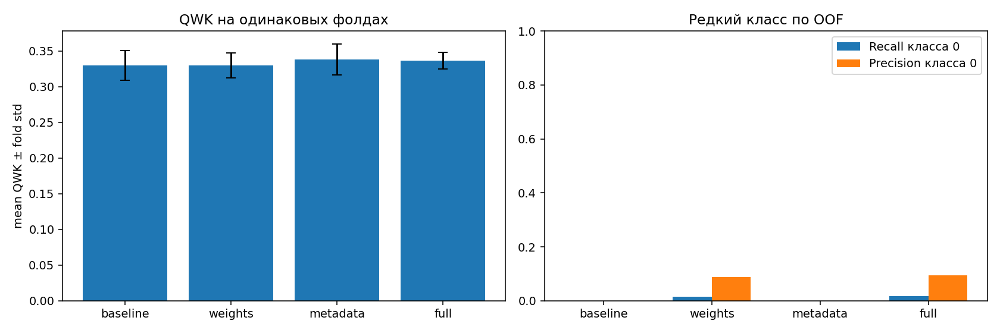

# PetFinder.my: прогноз скорости пристройства животных

Прогноз скорости пристройства животных по объявлениям PetFinder. В ДЗ1 сравнил пять моделей, в ДЗ2 проверил веса классов и метаданные первого фото для CatBoost.

## Быстрый запуск и основные метрики

Из корня `RND_ML_course_ITMO` в активированном окружении:

```bash
bash adoption_prediction/scripts/run_baseline.sh
```

Команда запускает EDA, Dummy и табличную Logistic Regression из `configs/baseline.yaml`. Результаты — в `adoption_prediction/outputs/baseline/summary.csv`. Установка окружения и получение данных описаны в [инструкции запуска](#запуск).

| Вариант | Mean QWK +- fold std | delta mean QWK к CatBoost ДЗ1 | OOF macro-F1 | OOF recall класса 0 |
|---|---|---:|---:|---:|
| Logistic Regression, бейзлайн ДЗ1 | 0.2594 +- 0.0201 | — | 0.2678 | 0.49% |
| CatBoost, ДЗ1 / исходный вариант ДЗ2 | 0.3299 +- 0.0205 | 0.0000 | 0.2870 | 0.00% |
| CatBoost + SqrtBalanced | 0.3300 +- 0.0173 | +0.0001 | 0.2962 | 1.46% |
| CatBoost + метаданные фото | **0.3382 +- 0.0218** | **+0.0083** | 0.2890 | 0.00% |
| CatBoost + веса + метаданные | 0.3365 +- 0.0120 | +0.0065 | **0.2986** | **1.71%** |

Все оценки получены на пяти одинаковых групповых фолдах по `RescuerID`, seed=42. Std показывает разброс по фолдам. Основная метрика — QWK, лучший вариант ДЗ2 по ней — метаданные без весов. Заранее выбранные критерии обеих гипотез ДЗ2 не выполнены: [результаты и абляции](#дз2-веса-классов-и-метаданные-фото).

[Выполненный ноут](notebooks/adoption_prediction_notebook.ipynb) ·
[Разбор ДЗ1](reports/2026-11-08_group_cv_seed42/analysis.md) ·
[Таблица экспериментов ДЗ2](reports/2026-11-16_hw2_group_cv_seed42/experiments.csv) ·
[Файлы результатов](reports/README.md)

## Задача

Нужно предсказывать `AdoptionSpeed` — категорию времени до пристройства животного. Объект наблюдения — объявление. Оно может представлять несколько животных. В таком случае метка относится к пристройству всей группы.

| Класс | Время до пристройства |
|---|---|
| 0 | В день публикации |
| 1 | 1–7 дней |
| 2 | 8–30 дней |
| 3 | 31–90 дней |
| 4 | Не пристроено после 100 дней |

Это многоклассовая классификация. Интервалы неравномерны, поэтому регрессия по кодам 0–4 не предсказывает точное число дней. Класс 4 также не означает, что животное никогда не будет пристроено.

`X` — характеристики животного и объявления: возраст, вид, породы, цвета, пол, размер, шерсть, здоровье, ветеринарные статусы, количество животных, цена, регион, число фото и видео. В отдельном эксперименте добавляется `Description`.
`y` — целое число от 0 до 4. Одно предсказание соответствует одному `PetID`.
`PetID` нужен для сопоставления строк, `RescuerID` — для группировки при валидации. В модели эти поля и `Name` не используются.

Практический смысл — находить объявления, которым может понадобиться продвижение. При этом в данных нет истории изменений карточки: нельзя подтвердить, что все описания, фото и статусы были доступны именно в день публикации.

## Данные и EDA

Источник — [PetFinder.my Adoption Prediction](https://www.kaggle.com/competitions/petfinder-adoption-prediction/data).
В CSV находятся таблица и текст, target есть только в train. Дополнительно доступны JPG, справочники категорий, sentiment JSON для описаний и Vision JSON для изображений. Для первого этапа использованы таблица и текст. Фото и JSON проверялись в EDA.

В train 14 993 объявления и 24 столбца с target, в test — 3 972 объявления и 23 столбца. В 19 табличных признаках нет NaN, но встречаются неопределенные статусы: например, Vaccinated=3 нельзя считать ответом «нет». Description отсутствует в 13 строках train и одной test. У Name пропусков больше, но этот признак не используется. Fee=0 означает бесплатное пристройство и не заменяется пропуском.

Классы несбалансированы: у редкого класса 0 всего 410 примеров (2.73%), остальные классы занимают от 20.61% до 27.99% train.


PetID уникальны, авторы train/test не пересекаются. Есть повторяющиеся описания, в том числе с разными метками и между train/test. Это могут быть шаблоны разных объявлений. Сами по себе повторы не доказывают ошибку разметки. Возможный шум — неточные сведения автора, задержка обновления статуса пристройства и широкие интервалы target. Риски утечки описаны в протоколе ниже.

Подробные проверки CSV, фото и JSON сохранены в [аудите EDA](reports/2026-11-08_group_cv_seed42/eda/audit.json), [числовые распределения](reports/2026-11-08_group_cv_seed42/eda/numeric_distributions.png) — отдельно. Новые категории test обрабатываются через OHE с игнорированием неизвестных значений и нативные категории CatBoost.

## Бейзлайн и гипотезы

Основной бейзлайн — Logistic Regression по 19 табличным полям. Это быстрая модель без сложных признаков, с которой удобно сравнивать последующие изменения. DummyClassifier нужен как контроль: он выбирает самый частый класс train-фолда.

| Модель | Подготовка данных и параметры |
|---|---|
| logreg_tabular | 5 числовых: медиана + StandardScaler, 14 категориальных: OHE. C=1, lbfgs, max_iter=1500 |
| logreg_text | То же + word TF-IDF по Description: 1–2 граммы, до 20 000 признаков, min_df=1, sublinear_tf |
| catboost_classifier | 19 табличных полей, нативные категории, MultiClass, 400 деревьев, depth=6, lr=0.05, l2=3 |
| catboost_regressor | Те же поля и параметры деревьев, RMSE, границы классов 0.5/1.5/2.5/3.5 |

Числовые поля — `Age`, `Quantity`, `Fee`, `VideoAmt`, `PhotoAmt`. Категориальные перечислены в [src/data.py](src/data.py). Коды категорий не считаются числовыми расстояниями. Пропуски категорий получают отдельное значение. Числовые NaN у CatBoost обрабатываются самой библиотекой. В TF-IDF не удаляются stopwords, поскольку описания многоязычные. Общий служебный токен позволяет обработать даже train-фолд, в котором все описания пустые.

Основная гипотеза: текст дополнит сведения из таблицы и даст **не менее +0.02 mean QWK**  к той же Logistic Regression. Дополнительный критерий — нижняя граница парного группового bootstrap-интервала для разницы pooled OOF QWK выше нуля.

| Исследовательский вопрос | Критерий | Результат |
|---|---|---|
| H1: помогает ли TF-IDF сверх таблицы? | Прирост mean QWK >=0.02 и положительный bootstrap-интервал | +0.0074, интервал включает ноль, критерий не выполнен |
| H2: лучше ли CatBoost линейного бейзлайна на тех же полях? | Прирост mean QWK >=0.03 | +0.0705, критерий выполнен на этом запуске |
| H3: помогает ли RMSE-регрессия по кодам классов? | Прирост mean QWK >=0.01 к CatBoostClassifier при меньшей MAE | QWK ниже на 0.0740, несмотря на меньшую MAE |

## Протокол оценки

Основная метрика — [Quadratic Weighted Kappa](https://www.kaggle.com/competitions/petfinder-adoption-prediction/overview/evaluation). Она учитывает порядок классов и сильнее штрафует большие расхождения.
Расчет: `cohen_kappa_score(y, pred, labels=[0,1,2,3,4], weights="quadratic")`. Дополнительно смотрю macro-F1, accuracy, MAE по кодам классов, recall класса 0 и долю ошибок на две категории и больше.

Валидация — **5-fold StratifiedGroupKFold по RescuerID, seed=42**. Карточки одного автора могут быть похожи, поэтому они попадают только в один validation-фолд. В данном train/test авторы также различаются. Все модели используют одни фолды. Предсказания вне обучения (OOF) и разбиение сохранены в результатах. Imputer, scaler, OHE и TF-IDF обучаются только внутри train-фолда. Внешний val не используется для early stopping или выбора порогов. Лучшая модель выбирается по mean fold QWK.

Пересечений авторов между фолдами нет, но 334 validation-строки (2.23% всех OOF) имеют описание из своего train-фолда. Это остаточный риск утечки, требующий осмотра текстов и более строгого разбиения при наличии реальных дубликатов. Обновления карточек после пристройства также не проверены. Без временных меток временной split не построить. Один seed и выбор из нескольких моделей ограничивают надежность оценки.
Bootstrap пересэмплирует целых авторов и относится к уже обученным OOF-моделям. Он не учитывает всю вариативность переобучения.

## Результаты и ошибки

Основные метрики вынесены в начало README. В ДЗ1 остальные модели получили mean QWK: Dummy — 0.0000, Logistic Regression с TF-IDF — 0.2668 +- 0.0162, CatBoostRegressor — 0.2559 +- 0.0121. Полная таблица — в [разборе ДЗ1](reports/2026-11-08_group_cv_seed42/analysis.md#сравнение-моделей).

Три примера ошибок табличного бейзлайна. Последний столбец показывает, что изменилось у лучшего CatBoost на том же validation-фолде:

| PetID | Признаки | y | Logistic Regression | CatBoost |
|---|---|---:|---:|---:|
| 6296e909a | Кот, 1 месяц, 1 животное, 2 фото | 0 | 4 | 1 |
| 3422e4906 | Собака, 1 месяц, 1 животное, 7 фото | 3 | 2 | 2 |
| 234a5a54c | Собака, 3 месяца, 3 животных, 5 фото | 4 | 2 | 2 |

По OOF бейзлайн почти не распознает редкий класс 0, смешивает соседние интервалы и для части долгих пристройств дает слишком оптимистичный прогноз. CatBoost уменьшил первую ошибку, но тоже не распознал класс 0.
Дополнительные метрики, bootstrap-интервал для H1, матрицы ошибок и сравнение на срезах — в [подробном разборе](reports/2026-11-08_group_cv_seed42/analysis.md).

## Выводы по ДЗ1

Таблица дает полезный сигнал, CatBoostClassifier получил лучший QWK. Добавление TF-IDF к линейной модели не дало требуемого прироста. RMSE-регрессия снизила MAE, но почти все ее ответы попали в классы 2 и 3, а QWK оказался хуже классификатора.
Также нужны осмотр дубликатов и повторение оценки с другими seed.

Следующая гипотеза была про веса классов: они повысят recall класса 0 без снижения mean QWK более чем на 0.01.

## ДЗ2: веса классов и метаданные фото

Исходный вариант — CatBoostClassifier из ДЗ1. Параметры деревьев сохранены в [configs/hw2.yaml](configs/hw2.yaml), фолды загружаются из результатов ДЗ1. Предсказания исходного CatBoost в двух ДЗ совпали. В четырeх вариантах меняются только веса классов и наличие блока метаданных. Test не используется для выбора модели.

**Веса классов.** Проверил `auto_class_weights="SqrtBalanced"` как умеренное увеличение вклада редких классов. Веса рассчитываются только внутри обучающей части фолда. Критерий: recall класса 0 не ниже 5% при снижении mean QWK не больше 0.01. Получилось 1.46% recall: верно распознаны 6 из 410 объявлений, precision — 8.82%. QWK почти не изменился (+0.0001), критерий гипотезы не выполнен.

Возможно, из-за того что SqrtBalanced довольно мягкая балансировка, гипотеза с добавлением весов классов не сработала.

**Метаданные первого фото.** Из `<PetID>-1.json` взял число и максимальный confidence меток, confidence `cat`/`dog`, средние RGB доминирующих цветов с весами `pixelFraction` и флаги отсутствующих данных. Признаки рассчитываются отдельно для каждой карточки без target и общих статистик. Метаданных нет у 341 объявления train — у всех этих карточек `PhotoAmt=0`.

Критерий — не менее +0.01 mean QWK к исходному CatBoost. Получилось **+0.0083**, прирост на четырeх из пяти фолдов. MAE снизилась с 0.9672 до 0.9574, число ошибок на две категории и больше — с 4 025 до 3 930. Но критерий гипотезы не достигнут. 95%-й парный групповой bootstrap-интервал разницы pooled OOF QWK — **[−0.0006; +0.0177]**, он включает ноль. Это положительный результат одного запуска, который пока не подтверждает устойчивый прирост.

Тут диагностировать почему гипотеза не прям вау сложнее, но, думаю, метаданных первого фото банально недостаточно.

**Две абляции** сравнивают полную версию с отключением одного компонента:

| Удалeнный компонент | Вариант без него | delta mean QWK: полная версия − без компонента |
|---|---|---:|
| Веса | Только метаданные | −0.0017 |
| Метаданные | Только веса | +0.0064 |

По точечным оценкам метаданные помогают полной версии, а веса поверх них немного ухудшают QWK. Bootstrap-интервалы обеих разниц pooled OOF QWK включают ноль. Интервалы получены по 500 пересэмплированиям целых авторов без переобучения моделей и не учитывают всю вариативность выбора лучшего варианта.



Для дальнейшей работы выбрал бы CatBoost с метаданными без весов: он получил лучший QWK и меньше тяжeлых ошибок. Проблема класса 0 остаeтся. Обе гипотезы не достигли выбранных критериев, хотя у метаданных есть небольшой наблюдаемый прирост.

Артефакты запуска 16.11.2026: [таблица экспериментов](reports/2026-11-16_hw2_group_cv_seed42/experiments.csv), [парные сравнения и абляции](reports/2026-11-16_hw2_group_cv_seed42/comparisons.csv), [метрики по классам](reports/2026-11-16_hw2_group_cv_seed42/class_metrics.csv), [матрицы ошибок](reports/2026-11-16_hw2_group_cv_seed42/confusion_matrices.png). Конфиги, окружение, метрики по фолдам и OOF каждого варианта сохранены в той же папке. Новые прогоны пишутся в `outputs/`.

С аугментацией (фоток) решил не работать, потому что, кажется, что добавление в датасет различных версий одной фотографии в этом случае может только ухудшить. Если просто расширять карточку, то смысла мало (чисто из человеческих соображений), а делать кропы, зашумлять, грейскейлить и так далее, опять же по человеческим признакам, не дает большей информации по питомцу. Да и пока в целом не работал с полноценными фотками.

## Запуск

Архив должен находиться в `data/petfinder-adoption-prediction.zip`. После клонирования его можно получить через `git lfs pull` (нужен установленный Git LFS).

Из корня `RND_ML_course_ITMO`:

```bash
python3 -m venv .venv
source .venv/bin/activate
cd adoption_prediction
python -m pip install -r requirements.txt
jupyter lab notebooks/adoption_prediction_notebook.ipynb
```

В VS Code можно открыть этот же ноутбук и выбрать Python из `.venv`. После перезапуска ядра выполняйте ячейки сверху вниз: начальные ячейки загружают модули и данные, которые нужны блоку ДЗ2. По умолчанию запускаются четыре варианта CatBoost для ДЗ2. Для повторения пяти моделей ДЗ1 включите `RUN_HW1=True`. Все модели работают на CPU, CSV распакуются в `data/raw/`, а JSON первого фото читаются прямо из ZIP. Результаты ДЗ2 сохраняются в `outputs/hw2_<дата и время>/`.

Для запуска только бейзлайна и Dummy без ноутбука из `adoption_prediction`: `bash scripts/run_baseline.sh`. Вместо ZIP можно передать путь к распакованным данным: `bash scripts/run_baseline.sh /path/to/data`.

## Проверки

```bash
python -m pytest tests -q
python scripts/verify_run.py --run-dir reports/2026-11-08_group_cv_seed42/experiments --refit-dir reports/2026-11-08_group_cv_seed42/refit --expected-test-rows 3972
python scripts/verify_run.py --run-dir reports/2026-11-16_hw2_group_cv_seed42/metadata
```

Команды выполняются из `adoption_prediction` после установки `requirements.txt`. Тесты используют небольшие синтетические данные и ZIP, включая повторную распаковку, LFS-указатель и проверку путей внутри архива. `verify_run.py` пересчитывает метрики по сохранeнным OOF без обучения; для других вариантов ДЗ2 замените `metadata` на `baseline`, `weights` или `full`. Артефакты запусков для сдачи хранятся в `reports/`.
