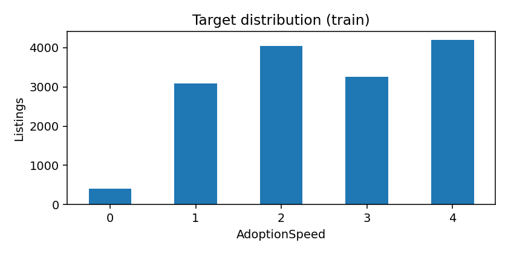
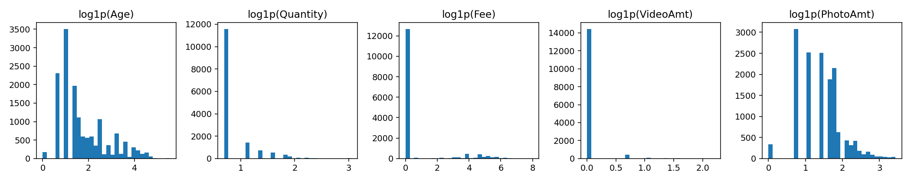
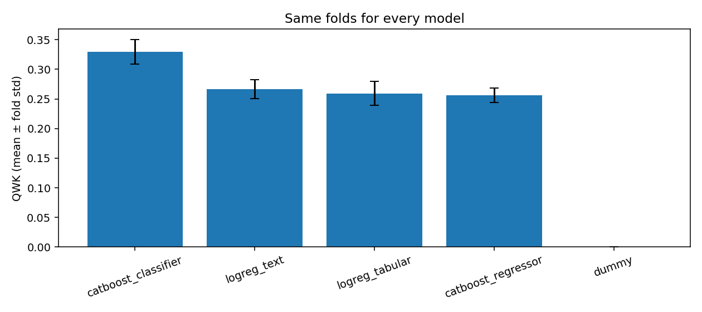
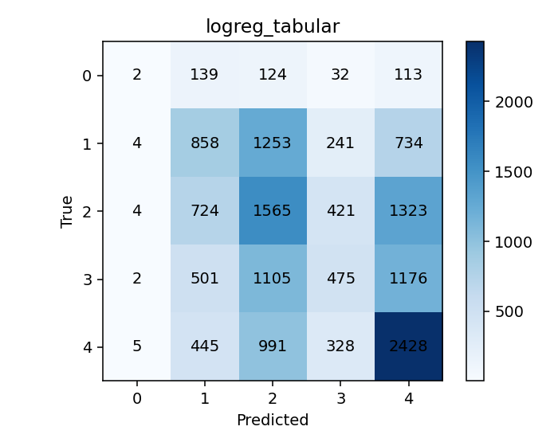
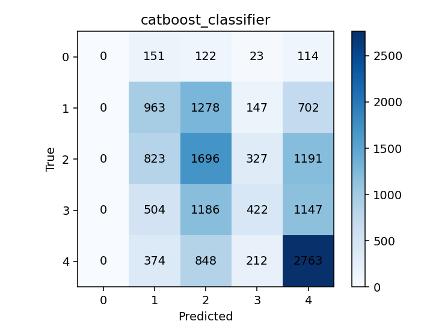

# Результаты и разбор ошибок

Запуск: 14 993 объявления train, 3 972 test, пять групповых фолдов по RescuerID, seed=42.ё

## Данные и ограничения оценки

В train 5 595 авторов, в test — 1 518; их множества не пересекаются.
Карточки одного автора не пересекают train/val внутри CV. 334 validation-строки имеют текст из соответствующего train-фолда. По фолдам таких строк 24, 44, 30, 38 и 198. На fold 4 это 6.53% validation; у всех четырех обучаемых моделей на нем самый низкий QWK.Но такой повторяющийся текст может быть шаблоном (?).

В 19 табличных признаках нет NaN, Description отсутствует в 13 строках train и одной test. Редкий класс 0 содержит 410 объявлений (2.73%). Нет фото и Vision JSON у 341/114 карточек train/test, sentiment — у 551/107. Полный [аудит](eda/audit.json) и [происхождение восстановленных таблиц](eda/provenance.json).

## Сравнение моделей

| Модель | Mean QWK +- fold std | Pooled OOF QWK | Macro-F1 | MAE | Ошибки >=2 классов | Время CV, с |
|---|---|---:|---:|---:|---:|---:|
| Dummy | 0.0000 +- 0.0000 | −0.0078 | 0.1188 | 1.4243 | 47.79% | 0.1 |
| Logistic Regression, таблица | 0.2594 +- 0.0201 | 0.2590 | 0.2678 | 1.0424 | 30.11% | 11.2 |
| Logistic Regression, таблица + TF-IDF | 0.2668 +- 0.0162 | 0.2665 | 0.2756 | 1.0368 | 29.61% | 194.3 |
| CatBoostRegressor | 0.2559 +- 0.0121 | 0.2562 | 0.1660 | **0.8882** | **16.18%** | 44.6 |
| CatBoostClassifier | **0.3299 +- 0.0205** | **0.3298** | **0.2870** | 0.9672 | 26.85% | 413.9 |

Время включает fit/predict и расчет метрик по фолдам. Fold std — разброс пяти фолдов. Dummy предсказывает класс 2 на fold 3 и 4 на остальных, поскольку выбирает моду каждого train-фолда. Поэтому его pooled QWK отличается от нулевого QWK каждого фолда.

**H1, текст.** Прирост mean QWK — +0.0074349; положителен на 3/5 фолдов. Разница pooled OOF QWK — +0.0074581, 95%-й групповой bootstrap-интервал [−0.0090941; 0.0260497], 500 ресэмплирований. Порог +0.02 не достигнут, интервал включает ноль: убедительного улучшения этим способом не получено. [Сохраненный результат](experiments/text_hypothesis.json).

**H2, CatBoostClassifier.** Прирост к табличному бейзлайну — +0.0705126 mean QWK, положителен на всех пяти фолдах. Критерий +0.03 выполнен. На собаках pooled QWK вырос с 0.2669 до 0.3307, на кошках — с 0.2206 до 0.3104. Различаются не только взаимодействия признаков, но и оптимизация и регуляризация двух семейств моделей.

| Возраст | n | Logistic Regression QWK | CatBoost QWK |
|---|---:|---:|---:|
| 0–2 месяца | 5 986 | 0.1869 | 0.2278 |
| 3–11 месяцев | 5 258 | 0.2281 | 0.2629 |
| >=12 месяцев | 3 749 | 0.2947 | 0.3120 |

Возрастные границы выбраны для описательного разбора после запуска;
они не использовались при выборе модели. [Исходные срезы](derived_age_slices.csv).

**H3, регрессия.** Mean QWK ниже классификатора на 0.0739750, хотя MAE меньше. Регрессор выдал класс 1 всего 51 раз, классы 2/3 — 14 661 раз (97.79%), класс 0 не выдал ни разу. Концентрация в середине шкалы уменьшила расстояние ошибок, но потеряла крайние классы. Это результат RMSE с фиксированными порогами.

## Какие ошибки изменились

Сравнение сделано по одним PetID, меткам и фолдам. CatBoost распознал правильно 1 790 объявлений, где Logistic Regression ошибалась, но ошибся на 1 274 объявлениях, которые бейзлайн распознавал верно. Разница — **516 дополнительных точных ответов**. Абсолютная ошибка уменьшилась у 2 658 карточек, выросла у 2 066 и не изменилась у 10 269. Число ошибок на >=2 категории снизилось с **4 515 до 4 025**.

| Истинный класс | n | Верно, Logistic Regression | Recall | Верно, CatBoost | Recall |
|---|---:|---:|---:|---:|---:|
| 0 | 410 | 2 | 0.49% | 0 | 0.00% |
| 1 | 3 090 | 858 | 27.77% | 963 | 31.17% |
| 2 | 4 037 | 1 565 | 38.77% | 1 696 | 42.01% |
| 3 | 3 259 | 475 | 14.58% | 422 | 12.95% |
| 4 | 4 197 | 2 428 | 57.85% | 2 763 | 65.83% |

Наибольший прирост точных ответов у класса 4 (+335), но на классе 3 стало на 53 правильных ответа меньше.

### 1. Пристройство в день публикации: класс 0

Бейзлайн распознал только 2 из 410 карточек. В 113 случаях он предсказал 4, а в 269 ошибся на две категории или больше. CatBoost сократил число таких тяжелых ошибок до 259, но вообще перестал предсказывать 0. Чаще всего он выдает для этого класса 1 (151 случай) или 2 (122 случая).

Пример: **6296e909a**, кот одного месяца, одно животное, два фото; y=0,
Logistic Regression=4, CatBoost=1. Здесь большая ошибка уменьшилась, но точного попадания все еще нет. Объяснить случай отсутствием фотографий нельзя: их две. Что в тексте или условиях пристройства отличает эту карточку, пока не проверено.

### 2. Смешение соседних интервалов: класс 3

У бейзлайна 1 105 ошибок 3->2 и 1 176 ошибок 3->4; вместе это около 70% класса 3. У CatBoost таких случаев 1 186 и 1 147, recall снизился с 14.58% до 12.95%. То есть классификатор лучше в целом, но не отделяет этот интервал надежнее. Следующая проверка — распределение вероятностей и калибровка решения на внутренних фолдах.

Пример: **3422e4906**, собака одного месяца, одно животное, семь фото; y=3, обе модели предсказывают 2. Ошибка на одну категорию сохраняется после замены модели. Наличие семи фото не гарантирует быстрое пристройство; их содержание не изучено.

### 3. Слишком оптимистичный прогноз: класс 4

Бейзлайн относит 991 из 4 197 объявлений класса 4 к классу 2; CatBoost — 848. Это уменьшение одного паттерна ошибок, но он остается частым. В целом для класса 4 число ошибок на >=2 категории снизилось с 1 441 до 1 222.

Пример: **234a5a54c**, собака трех месяцев, объявление о трех животных, пять фото; y=4, обе модели предсказывают 2. Метка относится ко всей группе, что важно при интерпретации. На всех групповых объявлениях доля тяжелых ошибок выше, чем на одиночных (см. таблицу ниже), но это наблюдение не устанавливает причину конкретного случая.
Нужно посмотреть, какие условия пристройства указаны в карточке.

## Фото и групповые объявления

| Срез | n | Тяжелые ошибки, Logistic Regression | Тяжелые ошибки, CatBoost |
|---|---:|---:|---:|
| Нет фото | 341 | 40.18% | 28.45% |
| Есть фото | 14 652 | 29.88% | 26.81% |
| Одно животное | 11 565 | 29.65% | 26.32% |
| Несколько животных | 3 428 | 31.68% | 28.62% |

У CatBoost accuracy на карточках без фото — 61.00%, но QWK всего 0.0896. В этом срезе 213 из 341 истинных меток — класс 4, а модель выдает 4 в 317 случаях. Постоянный ответ 4 дал бы accuracy 62.46%. Поэтому высокая accuracy здесь не означает хорошего разделения классов. Срез мал и отличается по target; эти числа не доказывают,
что добавление фотографии причинно улучшит пристройство или качество прогноза.

## Что осталось проверить

Индивидуальные причины ошибок не установлены: исходных текстов и фото трех разобранных карточек локально нет. Дальнейший ручной просмотр должен проверить шаблонность описаний, условия пристройства и возможные обновления после события. Выводы выше основаны на OOFю

Следующий эксперимент H7 — взвешивание классов у CatBoostClassifier на тех же фолдах и с тем же бюджетом. Критерий: recall класса 0 >=5% при снижении mean QWK не более 0.01. Повторение по seed и проверка дубликатов нужны до более сильных выводов.

## Refit

Выбран CatBoostClassifier. [Submission](refit/submission.csv) содержит 3 972 уникальных PetID: класс 1 — 699, класс 2 — 1 245, класс 3 — 242, класс 4 — 1 786.